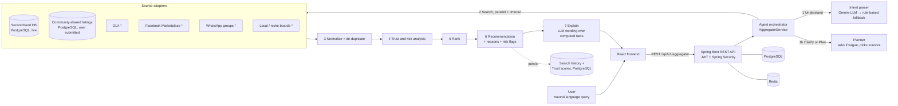

# Agentic AI-Based Trust-Aware Marketplace Aggregator

> Mini Project, Phase 1 · Dept. of Information Science & Engineering, Siddaganga Institute of Technology, Tumakuru
> Guide: Mrs. R B Sowmya, Assistant Professor

| Team member | USN |
| :-- | :-- |
| Rohit M Guddin | 1SI24IS080 |
| Pushkar R Adiga | 1SI24IS072 |
| Tanishraj H | 1SI24IS112 |
| Vrushank Kanmihalli Bhaskar | 1SI24IS124 |

**Problem.** Useful second-hand, rental and local-service listings are scattered across marketplaces, social groups and niche
boards. Users search each one by hand, meet duplicate / outdated / incomplete listings, and cannot easily tell which seller to trust.

**Solution.** A user types what they need in plain language. An AI agent understands the request, searches every permitted source
in parallel, merges duplicates, computes an **explainable Trust Score (0-100)** for each listing, and returns a ranked
recommendation with reasons and risk flags.

```
UNDERSTAND → (CLARIFY | PLAN) → SEARCH → AGGREGATE → ANALYZE → SCORE → RANK → RECOMMEND → EXPLAIN
```

The aggregator sits on top of an existing full-stack marketplace (Spring Boot + React + PostgreSQL + Redis + Kafka), which also
serves as its one *live* data source.

---

## Quick Start (Local Setup)

Follow these steps to run the complete stack locally on your machine.

### Prerequisites

| Tool | Required Version | Verification Command |
| :--- | :--- | :--- |
| **JDK** | 17 (Java 17 LTS) | `java -version` |
| **Node.js** | 20+ (with npm) | `node -v` && `npm -v` |
| **Docker & Docker Compose** | Recent (Docker Desktop running) | `docker compose version` |
| **Git** | Any | `git --version` |

> [!NOTE]
> - You do **not** need Maven pre-installed (the repository includes `./mvnw` and `mvnw.cmd`).
> - No external API keys or `.env` files are required for local development. By default, the AI agent uses intelligent deterministic rule fallbacks (an optional Google Gemini API key can be provided via `GEMINI_API_KEY` for LLM parsing).
> - All catalog data and category seed files are pre-bundled in `src/main/resources/data/`.

---

### Step 1: Clone the Repository

```bash
git clone https://github.com/tanishrajh/marketplace-aggregator.git
cd marketplace-aggregator
```

---

### Step 2: Start Infrastructure Services (Docker)

Start PostgreSQL, Redis, and Apache Kafka using Docker Compose:

```bash
docker compose up -d
```

Verify containers are running and healthy:
```bash
docker compose ps
```
* **PostgreSQL:** Port `5433` (configured to `5433` to prevent conflicts with default PostgreSQL on 5432)
* **Redis:** Port `6379`
* **Kafka:** Port `9092`

---

### Step 3: Run the Backend (Terminal 1)

Execute the Spring Boot backend using the local profile:

**On Linux / macOS:**
```bash
./mvnw spring-boot:run -Dspring-boot.run.profiles=local
```

**On Windows (PowerShell / CMD):**
```powershell
.\mvnw.cmd spring-boot:run "-Dspring-boot.run.profiles=local"
```

Wait until the console logs:
```
Started SecondHandApplication in ... seconds
```

**Verify Backend:**
* **Actuator Health:** [http://localhost:8080/actuator/health](http://localhost:8080/actuator/health)
* **Swagger / OpenAPI Documentation:** [http://localhost:8080/swagger-ui.html](http://localhost:8080/swagger-ui.html)
* **Aggregator Health Check:** `curl http://localhost:8080/api/v1/aggregator/health`

---

### Step 4: Run the Frontend (Terminal 2)

In a new terminal window, start the React Vite dev server:

```bash
cd secondhand-frontend
npm install
npm run dev
```

Open your browser at **[http://localhost:5173](http://localhost:5173)**.

---

### Step 5: Test the Application

1. **Natural Language Search:**
   Try queries like:
   * *"laptop under 40k in Bengaluru, trusted seller"*
   * *"PG or hostel near SIT Tumkur under 8000"*
   * *"cheapest used bicycle in Tumkur"*
2. **Explainable Trust Breakdown:**
   Click **Why this score?** on any listing to inspect Bayesian reputation, identity validation, price plausibility, and risk penalties.
3. **Agent Trace:**
   Expand the **Agent Trace** panel to watch the agent understand, plan, parallel-search, normalize, score, and rank listings.
4. **Share a Listing:**
   Navigate to **/share** to submit an external listing link (e.g., from OLX or Facebook Marketplace). It will be indexed immediately in PostgreSQL as a community listing.

---

### Alternative: Run Entire Stack via Docker

If you prefer running everything (infrastructure, backend, and frontend) in Docker without installing Java or Node.js:

```bash
docker compose -f docker-compose.full.yml up --build -d
```
* **Web App:** [http://localhost:3000](http://localhost:3000)
* **Backend API:** [http://localhost:8080](http://localhost:8080)

To shut down:
```bash
docker compose -f docker-compose.full.yml down
```

---

### Troubleshooting Common Issues

| Issue | Resolution |
| :--- | :--- |
| **Port Conflict (8080, 5173, 5433, 6379, 9092)** | Ensure no existing service or process is using these ports, or stop previous instances (`Get-Process -Id (Get-NetTCPConnection -LocalPort <PORT>).OwningProcess \| Stop-Process`). |
| **Docker Daemon not running** | Start Docker Desktop and wait until it is in the "running" state before running `docker compose up -d`. |
| **Database Connection Refused** | Ensure the Postgres container is healthy (`docker compose ps`). PostgreSQL is exposed on port `5433`. |
| **Need fresh database state** | Run `docker compose down -v` to reset database volumes, then rerun `docker compose up -d`. |

## 🖥️ How to Use the UI (User Interface Walkthrough)

The frontend is built with **React 19, Vite, and TailwindCSS**, designed to feel responsive, intuitive, and completely transparent about why listings are ranked the way they are.

```
┌────────────────────────────────────────────────────────────────────────────────────────┐
│  🔍 "laptop under 40k in Bengaluru, trusted seller"                         [Search]   │
│  [Popular: Laptops under 40k] [Hostels near SIT] [Used Bicycles] [iPhone 14]           │
│  Sort Priority: (●) Balanced   ( ) Trusted Seller   ( ) Lowest Price   ( ) Nearest     │
├────────────────────────────────────────────────────────────────────────────────────────┤
│  ⚡ Agent Trace: Understood (Rules) ➔ Plan (6 Sources) ➔ 34 Raw ➔ 12 Ranked (142ms)     │
├────────────────────────────────────────────────────────────────────────────────────────┤
│  ┌─────────────────────────────────────────────────────────────┐  ┌─────────────────┐  │
│  │ 💻 Lenovo ThinkPad T480 - Core i7 16GB RAM                 │  │ 🛡️ TRUST SCORE │  │
│  │ 📍 Bengaluru · 3 days ago · ₹34,500                         │  │      88/100     │  │
│  │ Source: SecondHand Live DB (Verified Seller)                │  │    HIGH TRUST   │  │
│  │ Reasons: Verified seller phone & email · Plausible price   │  │ [Why this score?]│  │
│  └─────────────────────────────────────────────────────────────┘  └─────────────────┘  │
└────────────────────────────────────────────────────────────────────────────────────────┘
```

### 1. Natural Language Search Bar & Prompt Chips
* **Conversational Query Input:** Instead of selecting 10 dropdowns and checkboxes, simply type what you want in everyday English (e.g. *"student study table in Tumkur under 2500"* or *"cheapest Honda Activa near Bengaluru"*).
* **Instant Suggestion Chips:** Click any quick-start query chip below the search bar to test the agent's parsing and ranking on representative real-world scenarios.

### 2. Preference Selector (Intent Biasing)
Fine-tune how the ranking algorithm prioritizes results without changing your query:
* **Balanced (Default):** Harmonic compromise between price, trust, distance, and query relevance.
* **Trusted Seller:** Prioritizes verified identity, high review counts, and zero risk flags.
* **Cheapest Deals:** Heavily weights lower price and discount depth while keeping basic scam filters active.
* **Nearby First:** Elevates listings closest to the detected city or campus.

### 3. Listing Cards & Source Badges
Each aggregated card clearly displays:
* **Canonical Price (₹ INR):** Automatically converted and standardized.
* **Location & Freshness:** City, locality, and days since publication.
* **Origin Source Tag:** Explicitly shows where the listing came from (`SecondHand Live DB`, `Community Shared`, `OLX`, `Facebook Marketplace`, `WhatsApp Groups`, or `Local Boards`).

### 4. Color-Coded Trust Badge
* 🟢 **High Trust (≥ 75):** Verified sellers, authentic descriptions, consistent market pricing, no risk triggers.
* 🟡 **Moderate Trust (50 – 74):** Legitimate listing, but seller might have few reviews, unverified phone, or older account.
* 🔴 **High Risk / Low Trust (< 50):** Scam triggers detected, price suspiciously below 30% of market median, or refusal of in-person inspection. These listings are automatically demoted to the bottom.

### 5. "Why this score?" Breakdown Modal
Clicking **Why this score?** on any listing card opens an itemized audit sheet showing:
* Exact point breakdown across all 7 signals (Seller Reputation, Identity Verification, Listing Quality, Price Plausibility, Freshness, Source Prior, Cross-Source Corroboration).
* Active penalty deductions (e.g. `−25: Advance payment requested in description`).

### 6. Interactive "Agent Trace" Drawer
Expand the **Agent Trace** at the top of the search results to observe the AI's internal thought process:
* **Understood Intent:** Extracted JSON schema (keyword, category, city, budget range, condition).
* **Planning Decision:** Which sources were selected and which were skipped (with exact justification).
* **De-duplication:** Which listings across different platforms were recognized as identical and merged.
* **Relaxation Events:** If too few listings were found, shows how the agent relaxed constraints to find alternatives.

### 7. Clarification Dialog
When a query is too vague to search responsibly (e.g. *"under 5000 in Tumkur"* without naming an item), the UI displays a clarification prompt asking what item you are looking for instead of guessing blindly.

### 8. Community Listing Portal (`/share`)
Allows any user to crowdsource a listing from platforms without open APIs. Users provide the item title, price, city, and a link to the original listing. It is immediately ingested into PostgreSQL and indexed for subsequent search queries.

---

## 🔬 Step-by-Step Deep Dive: What Happens When You Type a Sentence?

Here is the exact lifecycle of what happens under the hood when you enter a query like:
> **`"laptop under 40k in Bengaluru, trusted seller"`**

```mermaid
sequenceDiagram
    autonumber
    actor User
    participant FE as React Frontend
    participant API as AggregatorController
    participant INT as IntentParser
    participant PLN as Planner
    participant SRC as 6x SourceAdapters (Async)
    participant NORM as Normalizer & De-duplicator
    participant TRST as TrustScoringService
    participant RNK as RankingService
    participant EXP as Explainer & DB

    User->>FE: Types "laptop under 40k in Bengaluru, trusted seller"
    FE->>API: POST /api/v1/aggregator/search { query, limit: 10 }
    API->>INT: 1. Parse natural language into structured intent
    INT-->>API: Intent: { keyword: "laptop", cat: ELECTRONICS, maxPrice: 40000, city: "Bengaluru", pref: TRUSTED }
    API->>PLN: 2. Check ambiguity & plan source execution
    PLN-->>API: Plan: Query all sources covering ELECTRONICS; skip irrelevant feeds
    API->>SRC: 3. Dispatch parallel asynchronous search (CompletableFuture)
    SRC-->>API: Collect raw listings with per-source timeouts
    API->>NORM: 4. Canonicalize to INR & cluster near-duplicates (Jaccard + Levenshtein)
    NORM-->>API: Deduplicated unified listings
    API->>TRST: 5. Calculate 7 positive signals + deduct scam risk penalties
    TRST-->>API: Explainable Trust Scores (0-100) + Risk Flags
    API->>RNK: 6. Multi-objective ranking (weighted by preference: TRUSTED)
    RNK-->>API: Ranked listings (Low-trust items penalized x0.55)
    opt Fewer than 3 results
        API->>API: 6b. Agentic Reflection: Relax condition/city/budget and re-query
    end
    API->>EXP: 7. Synthesize grounded comparison & persist to PostgreSQL
    EXP-->>API: Formatted response + Agent Trace
    API-->>FE: HTTP 200 JSON payload
    FE-->>User: Renders interactive ranked cards with badges & trace
```

---

### Phase 1: Request Dispatch & Security Ingestion
1. The React frontend sends an HTTP `POST` request to `/api/v1/aggregator/search` with the payload:
   ```json
   {
     "query": "laptop under 40k in Bengaluru, trusted seller",
     "limit": 10
   }
   ```
2. The Spring Boot backend passes the request through the `RateLimitingFilter` (allowing up to 10 requests/second per IP) and `SecurityConfig` (publicly accessible, no login token required).

---

### Phase 2: Intent Understanding & Parsing (`aggregator/intent/`)
The query is transformed into a structured `SearchIntent` object using either Google Gemini (if `GEMINI_API_KEY` is present) or the built-in deterministic regex engine:
* **Keyword Extraction:** Identifies `"laptop"` as the primary search term.
* **Category Classification:** Maps `"laptop"` to the canonical category `ELECTRONICS`.
* **Budget Extraction:** Parses `"under 40k"` into `maxPrice: 40000.0` (recognizing `k`, `thousand`, `lakh`, `cr`, and raw digits). `minPrice` is set to `null`.
* **Location Extraction:** Identifies `"Bengaluru"` as the target city (supporting Bangalore, Bengaluru, Tumkur, Mysuru, Delhi, Mumbai, etc.).
* **Preference Extraction:** Identifies `"trusted seller"` and sets preference to `Preference.TRUSTED`.
* **Condition Extraction:** Detects whether the user specified "new", "used", "refurbished", or "any".

---

### Phase 3: Agentic Planning & Clarification (`aggregator/plan/`)
1. **Ambiguity Gate:** The agent checks if both keyword and category are missing (e.g. `"under 5000 in Tumkur"`). If missing, it immediately aborts the search and responds with a polite clarifying question.
2. **Coverage Pruning:** The planner inspects the registered sources (`SecondHand DB`, `Community Listings`, `OLX`, `Facebook Marketplace`, `WhatsApp Groups`, `Local Boards`). If a source declares it only carries `REAL_ESTATE`, it is skipped for this `ELECTRONICS` search. Sources with dynamic coverage (the live database and community listings) are **never skipped**.

---

### Phase 4: Parallel Multi-Source Search (`aggregator/source/`)
1. All approved sources are queried **concurrently in parallel** using Java `CompletableFuture.allOf()` across a dedicated thread pool.
2. **Fault Isolation:** Each source adapter runs with an isolated timeout (e.g., 1500ms). If an external source is slow or fails, its failure is logged in the agent trace, but the pipeline never crashes—it proceeds with the remaining available sources.

---

### Phase 5: Normalization & De-duplication (`aggregator/normalize/`)
1. **Schema Standardization:** All raw listings from all sources are converted into a unified `RawListing` schema:
   * Prices are standardized to Indian Rupees (INR).
   * City names and categories are canonicalized.
2. **Cross-Platform Duplicate Detection:**
   * Sellers frequently post the same item on both OLX and Facebook Marketplace.
   * The deduplicator calculates **token Jaccard similarity** and **Levenshtein distance** on titles and descriptions, matching against price proximity (within ±10%).
   * When a duplicate is detected, the listings are merged into a single entry with multi-source attribution, and the item receives an automatic **+10 Cross-Source Corroboration** bonus in trust scoring.

---

### Phase 6: Multi-Dimensional Trust & Risk Scoring (`aggregator/trust/`)
The `TrustScoringService` evaluates each listing against 7 distinct mathematical signals:

$$\text{TrustScore} = \sum_{i=1}^{7} S_i - \text{RiskPenalties}$$

1. **Seller Reputation (25 pts):** Uses Bayesian smoothing to prevent sellers with a single 5-star review from unfairly outranking seasoned sellers with hundreds of 4.8-star reviews:
   $$\text{Rating}_{\text{Bayes}} = \frac{v \cdot R + m \cdot C}{v + m}$$
   *(where $v$ is review count, $R$ is seller rating, $m$ is minimum threshold weight, and $C$ is global mean rating).*
2. **Seller Identity (15 pts):** Points awarded for verified phone number, verified email, and account age (> 1 year).
3. **Listing Quality (20 pts):** Points for high-resolution images, descriptive text (> 50 words), and precise neighborhood location.
4. **Price Plausibility (15 pts):** Computes the dynamic median price of comparable items across the entire search batch. If a listing is priced reasonably within 0.7× to 1.4× of the median, it receives full points.
5. **Freshness (10 pts):** Exponential decay based on days since posting. A listing posted 2 days ago receives more points than one posted 60 days ago.
6. **Source Reliability (5 pts):** Inherent baseline reliability prior of the hosting platform.
7. **Cross-Source Corroboration (10 pts):** Awarded if the listing is corroborated across multiple independent sources.
8. **Risk Penalties (up to −45 pts):**
   * Scans text for high-risk scam triggers (e.g., *"advance payment required"*, *"courier charges before delivery"*, *"send Google Pay screenshot"*, *"army officer transfer scam"*).
   * Severe penalty if price is absurdly low (< 30% of market median).

---

### Phase 7: Dynamic Multi-Objective Ranking (`aggregator/rank/`)
The final ranking score balances relevance, trust, price, location, and user preference:

$$\text{FinalScore} = w_R \cdot \text{Relevance} + w_T \cdot \text{Trust} + w_P \cdot \text{Price} + w_L \cdot \text{Location} + w_U \cdot \text{Preference}$$

* Because the user specified `"trusted seller"`, the weights dynamically adapt:
  * **Relevance ($w_R$):** `0.30`
  * **Trust ($w_T$):** `0.45` *(elevated from standard 0.30)*
  * **Price ($w_P$):** `0.10`
  * **Location ($w_L$):** `0.08`
  * **Preference ($w_U$):** `0.07`
* **The Scam Damper:** Any listing that scored `< 50` on Trust is multiplied by **`0.55`**, ensuring scam deals never appear at the top regardless of keyword match.

---

### Phase 8: Agentic Reflection & Self-Correction
If fewer than 3 listings survive the filters:
1. The agent automatically triggers **Reflection Mode**.
2. It progressively relaxes the most restrictive constraints:
   * **Step 1:** Relax item condition (e.g. from "Like New" to "Any").
   * **Step 2:** Relax city boundary (searching state-wide or adding nearby hubs).
   * **Step 3:** Expand budget by +25%.
   * **Step 4:** Re-query and re-rank.
3. Every relaxation step is transparently logged in the `agentTrace` array and displayed in the frontend drawer.

---

### Phase 9: Grounded Explanation & Persistence (`aggregator/explain/`)
1. **Explainable Output:** A factual comparison of the top choices is generated (via Gemini LLM if key is set, or template synthesizer). The explainer is strictly forbidden from hallucinating new facts—it only narrates computed metrics.
2. **Audit Persistence:** The search query, intent, execution duration, and trust score metrics are asynchronously written to PostgreSQL tables (`aggregator_search_history` and `aggregator_trust_scores`) for auditing and user history.
3. **Frontend Rendering:** The browser receives the JSON response and displays ranked listing cards, interactive score sheets, and the complete step-by-step trace.

---

## Architecture


\* Four sources use clearly-labelled **simulated datasets** (`src/main/resources/aggregator/*.json`) because scraping these platforms is
not permitted. Real third-party listings enter the system the permitted way: people **share** them through the app
(`/share`), and each simulated adapter can later be replaced by a real adapter built on an official API / partner feed
(see [Adding a real source](#adding-a-real-source)). Live data today: the SecondHand database and community-shared listings.

Deployment target (Phase 2): Dockerised frontend + backend on AWS (EC2, ECR, RDS, S3). See [`docs/AWS_DEPLOYMENT.md`](docs/AWS_DEPLOYMENT.md).

### The agent, step by step

| # | Step | What happens | Code |
| :-: | :-- | :-- | :-- |
| 1 | **Understand** | Query → structured intent: keywords, category, min/max budget, city, condition, preference (*trusted / cheapest / nearby*). Gemini if a key is set, otherwise (or on any failure) deterministic rules. | `aggregator/intent/` |
| 1b | **Clarify / Plan** | A request with neither a keyword nor a category ("under 5000 in Tumkur") makes the agent **ask a question** instead of guessing. Otherwise the agent **plans**: it chooses which sources are worth querying (Gemini decides when available; otherwise a rule skips sources whose datasets have no listings of the requested category). Sources with unknown coverage - the live database and community listings - are never skipped. The plan and its reason appear in the trace. | `aggregator/plan/` |
| 2 | **Search** | The planned sources are queried in parallel with a per-source timeout; a slow or failing source is reported but never blocks the rest. | `aggregator/source/`, `AggregatorService` |
| 3 | **Aggregate & normalize** | One schema for all sources: prices converted to INR, canonical city / category / condition. Near-duplicate listings across sources are clustered and merged. | `aggregator/normalize/` |
| 4 | **Analyze & score** | Explainable Trust Score from the signals actually available, minus risk penalties. | `aggregator/trust/` |
| 5 | **Rank** | Weighted blend of relevance, trust, price, location and preference. | `aggregator/rank/` |
| 6 | **Recommend** | Top results with plain-language reasons, risk flags, and the agent's full trace. If fewer than 3 results survive, the agent **reflects**: it relaxes the least important constraint (condition → city → budget +25% → category, re-opening all sources when the category is dropped) and searches again; every relaxation is shown in the trace. | `AggregatorService` |
| 7 | **Explain** | With a Gemini key, an LLM writes a short comparison of the top results. It sees only values the pipeline already computed and is told not to invent facts, so it can change the wording but never the scores or order. Without a key the built-in summary is shown. | `aggregator/explain/` |

Everything the LLM touches (understand, plan, explain) has a deterministic fallback, so the system works fully offline and never fails because a model call did.

**What is stored in PostgreSQL:** users and listings (the platform), every search (`aggregator_search_history`), the trust score and risk flags of every returned listing (`aggregator_trust_scores`), and community-shared listings (`aggregator_community_listings`). Signed-in users can read their own history at `GET /api/v1/aggregator/history`.

### Trust Score (0-100)

| Signal | Max | Based on |
| :-- | :-: | :-- |
| Seller reputation | 25 | Bayesian-smoothed rating weighted by review count |
| Seller identity | 15 | verified, phone on file, account age |
| Listing quality | 20 | photos, description, price, location, condition |
| Price plausibility | 15 | price vs. median of comparable listings in the same search |
| Freshness | 10 | days since posting |
| Source reliability | 5 | prior trust in the platform |
| Cross-source match | 10 | same item corroborated on several sources |
| **Risk penalties** | up to −45 | advance/token payment requests, untraceable payment, refusing meetups, scam stories, price far below market |

Levels: **High ≥ 75**, **Medium 50-74**, **Low < 50** (shown as "High risk" and down-ranked ×0.55 so a too-good-to-be-true deal never leads).

### Ranking

`final = wR·relevance + wT·trust + wP·price + wL·location + wU·preference`

| User intent | Relevance | Trust | Price | Location | Preference |
| :-- | :-: | :-: | :-: | :-: | :-: |
| balanced (default) | 0.35 | 0.30 | 0.15 | 0.10 | 0.10 |
| "trusted" | 0.30 | 0.45 | 0.10 | 0.08 | 0.07 |
| "cheapest" | 0.30 | 0.22 | 0.30 | 0.10 | 0.08 |
| "nearby" | 0.30 | 0.25 | 0.10 | 0.27 | 0.08 |

---

## API

Public endpoints (no login needed). Interactive docs: http://localhost:8080/swagger-ui.html

| Method | Path | Purpose |
| :-- | :-- | :-- |
| `POST` | `/api/v1/aggregator/search` | `{ "query": "...", "limit": 10 }` → intent, per-source report, ranked listings with trust breakdown, summary, agent trace |
| `POST` | `/api/v1/aggregator/submit` | Share a listing found elsewhere (title, price, city, link to the original post...). Validated; capped at 60 per hour in total; unverified by design |
| `GET` | `/api/v1/aggregator/history` | The signed-in user's recent searches (requires login) |
| `GET` | `/api/v1/aggregator/sources` | Registered sources |
| `GET` | `/api/v1/aggregator/health` | Liveness check |

```bash
curl -s -X POST http://localhost:8080/api/v1/aggregator/search \
  -H "Content-Type: application/json" \
  -d '{"query":"PG near SIT Tumkur under 8000"}'
```

---

## Project layout

```
src/main/java/com/serhat/secondhand/
  aggregator/          ← THIS PROJECT: intent, plan, source, community, normalize, trust, rank, explain, history, service, api, demo seed
  ai/                  ← Gemini client reused by the intent parser
  listing/ user/ ...   ← underlying marketplace (the "SecondHand (Internal DB)" source)
src/main/resources/aggregator/   simulated source datasets (JSON)
src/test/java/.../aggregator/    unit tests: intent parser, trust scoring, duplicate detector, pipeline
secondhand-frontend/src/aggregator/   React search page, share-a-listing page, trust badge, score breakdown, agent trace
docker-compose.yml        local infra only (Postgres, Redis, Kafka)
docker-compose.full.yml   whole stack in containers (also the shape deployed on AWS)
docs/                     LOCAL_SETUP.md, AWS_DEPLOYMENT.md + original platform docs
```

### Tests

```bash
./mvnw test -Dtest='com.serhat.secondhand.aggregator.**.*Test'
```

### Real-World Data Sources & Verified Adapters

In addition to the simulated sandbox feeds, the aggregator includes **active real-world source adapters** designed for student and campus ecosystems:

| Source ID | Adapter | Real-World Coverage & Integration |
| :-- | :-- | :-- |
| `verified-places` | `VerifiedPlacesSourceAdapter` | Real student PGs, hostels, and student amenities around SIT Tumkur & Bengaluru. Includes verified student residencies (SLV Comforts, Sri Manjunatha Gents PG, Sri Venkateshwara Ladies PG near SIT gate, Siddaganga Math Hostel, Vidya Book House, Maruthi Cycle Mart). Supports live OpenStreetMap (Overpass API) spatial search and optional Google Places API (`places.google.api-key`). Marked as `simulated: false`. |
| `certified-market` | `CertifiedProductsSourceAdapter` | Certified refurbished tech (ThinkPad T480, MacBook Air M1, Dell Latitude), campus transport (Hero Sprint, Btwin cycles), study furniture (ergonomic mesh chairs), and VTU academic textbook sets. Supports live Google Shopping / SerpApi web lookup (`shopping.serpapi.key`). Marked as `simulated: false`. |
| `secondhand-internal` | `DemoDataSeeder` (Live DB) | Real student listings seeded into the local PostgreSQL database: Silberschatz OS textbooks, Casio fx-991EX scientific calculators, VTU solved paper sets, and campus room rentals. |

**Verified Real-World UI Filter:** The web interface provides a dedicated **"Verified Real-World only"** filter pill that instantly filters results to genuine, non-simulated listings displaying the prominent green **"Real-World Verified"** badge.

### Adding a new source

Implement `SourceAdapter` (`info()`, `search(SearchIntent)` returning `RawListing`s, and optionally `coverage()` so the planner can skip it for irrelevant requests) as a Spring `@Component` (the service automatically injects every `SourceAdapter` bean, so no manual registration is needed). Everything downstream (normalisation, de-duplication, trust, ranking, UI) works unchanged.

### Turning on the LLM

Set `GEMINI_API_KEY` (see `.env.template`). The agent then parses queries with Gemini and silently falls back to the rule-based
parser if the call fails; the "understood by" chip in the UI shows which one ran.

---

## Roadmap

- [x] **Phase 1** - multi-source aggregation, planning + clarification + reflection, normalisation, de-duplication, explainable trust score, ranking, optional LLM explanation, search/score persistence, community-shared listings, web UI, Docker
- [x] **Real-World Integrations** - verified campus PG & hostel spatial adapter (OpenStreetMap Overpass + Google Places), certified refurbished tech & academic catalog adapter, real-world UI toggle & badges
- [ ] **Phase 2** - deploy on AWS (EC2 + ECR + RDS + S3), moderation of shared listings, saved searches and price alerts
- [ ] Learn ranking weights from user feedback; seller-reported scam feedback loop into the trust score

## Foundation & references

Built on the open-source *SecondHand* C2C marketplace (Spring Boot 3.5, React 19, PostgreSQL, Redis, Kafka); the original
platform documentation is kept in [`docs/`](docs/) and `.agents/`. Literature references are listed in the Phase 1 presentation
(Adomavicius & Tuzhilin 2005; Lops et al. 2011; Zhang et al. 2019; Luca 2017; Zhou et al. 2018).

# market-place-agg
