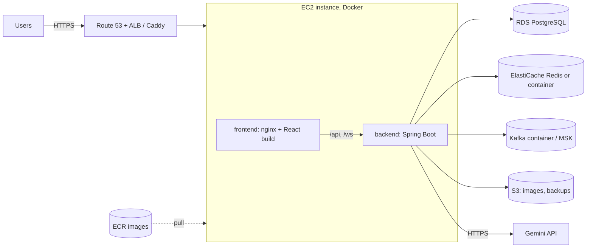

# Deploying on AWS (Phase 2 plan)

The Phase 1 architecture shows **Dockerised services → AWS (EC2, ECR, RDS, S3)**. This guide takes the exact containers you run
locally with `docker-compose.full.yml` and puts them on AWS in three increasing steps. Do step A first; B and C are upgrades.

> Status: the container images and compose file are ready and are what you run locally. The AWS steps below have **not** been
> executed yet (no AWS account was available while writing this); treat commands as a checklist and adjust names/regions.

## Target architecture



| Component | Local | AWS |
| :-- | :-- | :-- |
| Frontend (React build) | `frontend` container (nginx) | same image, from ECR, on EC2 (later: S3 + CloudFront) |
| Backend | `backend` container | same image, from ECR, on EC2 |
| PostgreSQL | `postgres` container | **RDS** PostgreSQL 15 |
| Redis | `redis` container | container on EC2, later **ElastiCache** |
| Kafka | `kafka` container | container on EC2, later **MSK** |
| Images / uploads | Cloudinary | Cloudinary now, later **S3** |
| Secrets | `.env` | **SSM Parameter Store / Secrets Manager** |

## Before you start: one important caveat about the Spring profile

`prod` turns on Flyway + schema *validation* and refuses weak secrets. The shipped Flyway baseline does **not** cover every
entity column (see the note in `application-local.yml`), so `prod` will fail schema validation until the migrations are completed.
Until then deploy with `SPRING_PROFILES_ACTIVE=local` (Hibernate creates/updates the schema) **but with your own secrets**:
set `JWT_SECRET_KEY` (≥ 32 random chars), a strong `DB_PASSWORD`, and `AGGREGATOR_DEMO_SEED=false` if you do not want demo data.
Switch to `prod` once you have generated complete migrations (for example by exporting the schema Hibernate created and adding it as
`V2__…sql`).

## Step A - single EC2 instance, everything in Docker (cheapest, ~30 min)

1. **Launch EC2**: Ubuntu 22.04 or Amazon Linux 2023, **t3.medium** (4 GB RAM; Kafka + Spring Boot + Postgres do not fit in 2 GB),
   30 GB gp3 disk, key pair. Security group inbound: 22 (your IP only), 80 and 443 (anywhere). Do **not** open 5432/6379/9092/8080.
2. **Install Docker** (Ubuntu):
   ```bash
   sudo apt-get update && sudo apt-get install -y docker.io docker-compose-v2 git
   sudo usermod -aG docker $USER && newgrp docker
   ```
3. **Get the code and configure**:
   ```bash
   git clone <your-repo-url> app && cd app
   cp .env.template .env
   nano .env     # set DB_PASSWORD, JWT_SECRET_KEY (openssl rand -hex 32), GEMINI_API_KEY (optional)
   ```
4. **Expose the frontend on port 80**: in `docker-compose.full.yml` change the frontend ports to `"80:80"`, and remove the
   `ports:` entry of `backend` (nginx proxies `/api` internally). Set `FRONTEND_URL` / `CORS_ALLOWED_ORIGINS` on the backend to
   `http://<EC2-public-IP>` (or your domain).
5. **Start**: `docker compose -f docker-compose.full.yml up --build -d`
6. **Check**: open `http://<EC2-public-IP>`; `docker compose -f docker-compose.full.yml logs -f backend`.
7. **HTTPS** (needed for secure cookies): point a domain at the instance and either put **Caddy** in front (automatic Let's Encrypt)
   or use an **ALB + ACM certificate**; then set `COOKIE_SECURE=true` and `COOKIE_DOMAIN=<your-domain>` on the backend.

## Step B - images in ECR, database in RDS

1. **Create ECR repositories** and push (from your laptop or CI):
   ```bash
   REGION=ap-south-1; ACCOUNT=$(aws sts get-caller-identity --query Account --output text)
   REG=$ACCOUNT.dkr.ecr.$REGION.amazonaws.com
   aws ecr create-repository --repository-name trust-aggregator-backend  --region $REGION
   aws ecr create-repository --repository-name trust-aggregator-frontend --region $REGION
   aws ecr get-login-password --region $REGION | docker login --username AWS --password-stdin $REG

   docker build -t $REG/trust-aggregator-backend:v1  .
   docker build -t $REG/trust-aggregator-frontend:v1 ./secondhand-frontend
   docker push $REG/trust-aggregator-backend:v1
   docker push $REG/trust-aggregator-frontend:v1
   ```
2. **Create RDS PostgreSQL 15** (db.t4g.micro for a demo), database name `secondhand`, **not** publicly accessible, in the same
   VPC; its security group allows 5432 only from the EC2 instance's security group.
3. **Give the EC2 instance an IAM role** with `AmazonEC2ContainerRegistryReadOnly` so it can pull from ECR
   (`aws ecr get-login-password … | docker login …` on the instance).
4. **Run from ECR, using RDS**: create `docker-compose.aws.yml` on the instance that contains only `redis`, `kafka`, `backend`
   and `frontend` from `docker-compose.full.yml`, replace the `build:` blocks by `image: $REG/trust-aggregator-…:v1`, and set the
   backend's `DB_URL=jdbc:postgresql://<rds-endpoint>:5432/secondhand`, `DB_USER`, `DB_PASSWORD`; drop `depends_on: postgres`.
5. `docker compose -f docker-compose.aws.yml up -d`.

## Step C - hardening and scaling

- **S3**: user-uploaded images and nightly `pg_dump` backups (attach an instance role with access to one bucket only). For a
  static frontend: build with `npm run build`, upload `dist/` to S3, serve through CloudFront, and route `/api/*` to the ALB.
- **ElastiCache (Redis)** and **MSK (Kafka)** instead of containers; set `REDIS_HOST` and `KAFKA_BOOTSTRAP_SERVERS`.
- **Secrets**: move `JWT_SECRET_KEY`, `DB_PASSWORD`, `GEMINI_API_KEY` to SSM Parameter Store / Secrets Manager.
- **Scale out**: ECS Fargate (or an Auto Scaling group behind the ALB) running several backend tasks; the backend is stateless
  apart from Redis/PostgreSQL. Aggregator sources run in a bounded thread pool per instance, so scale on CPU / request latency.
- **Observability**: Prometheus + Grafana configs already exist in the repo (`prometheus.yml`, `grafana/`); in `prod` the metrics
  are on management port 9090 (keep it private). Add CloudWatch alarms on ALB 5xx and RDS CPU.
- **CI/CD**: GitHub Actions workflow: build → test → push images to ECR → SSH/SSM command `docker compose pull && up -d`.

## Rough cost (ap-south-1, always on, indicative only - check the AWS calculator)

t3.medium ≈ US$30-35/mo, RDS db.t4g.micro ≈ US$15-20/mo, EBS/ECR/S3 a few dollars. **Stop the instance and RDS when not demoing**
and set an AWS Budget alert.
